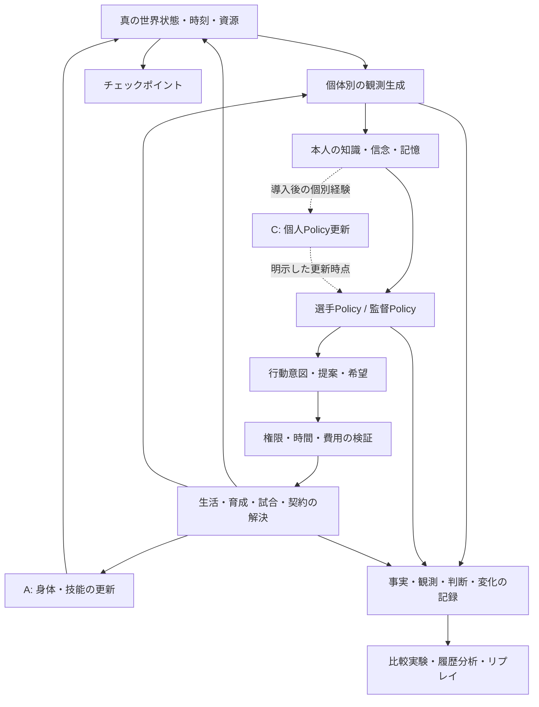

# 技術構想 v0.1 — 仮説と交換可能な境界

2026-11-04。憲章の目的は固定し、この文書の方法・係数・規模は実験で変更する。**将来構想を含む。実装済み範囲は [STATUS](STATUS.md) と実験結果を参照。**

2026-11-09時点: T017まで実装。4クラブ12選手、整数会計、私的MindのPolicy、測定による疲労認識、T015初期範囲生成、save16の記録付き介入/全再演保存を持つ。T016は初期育成集団の比較と移籍なし集団の記述を分離する評価修正。T017は生成集団を通常CLIへ接続した。世界進行の変更ではない。最新の[結果](experiments/T017-RESULTS.md)と[STATUS](STATUS.md)を実装範囲の正本とする。

## 1. 全体像

初期案は、描画不要の個体ベースシミュレーション（ABM）に、交換可能な判断関数と学習更新を接続する構成。まず行動と認識の閉ループを作り、競技空間とニューラル学習を順次追加する。

図のBはAと独立した知識・認識更新。ログからPolicyへの直接矢印を設けない。世界の完全ログを読むのは研究者側の分析器で、エージェントは公開・伝達・観測された内容だけを取得する。描画と記事生成は状態を変更しない読み取り側とする。

## 2. 4つの状態を分ける

| 層 | 内容 | 閲覧者・寿命 |
|---|---|---|
| 真の内部状態 | 技能、疲労、潜在学習特性、負傷、契約、実際の知識保持状態 | 状態遷移が使用。研究者は監査できるがPolicyに丸ごと渡さない |
| 個体の認識 | 自分/他者の能力推定、信頼、方法への期待、情報の確信度・出所・鮮度 | 当該個体。観察/経験/伝達で更新される永続状態 |
| 判断の内部表現 | 観測特徴量、検索された記憶、候補の得点、NN活性、RNN文脈 | 決定単位の一時状態。学習済み重みや明示的な長期記憶とは別 |
| 表示用の評価 | 0–100などへの要約、スカウト評、本人評価、観測時点/不確実性 | 閲覧権限に応じた表示。真値・本人評価・他者評価をラベルで区別 |

「実際にどの命題を保持しているか」は世界の状態に含められるが、その命題が正しいとは限らない。戦術に唯一の正解がない場合、知識を真偽1bitに還元せず、経験した条件・成功率推定・不確実性を保持する。選手自身も潜在上限や未来を正確に知らない。

T001ではコピーした観測/信念を関数へ渡すだけで十分。汎用のアクセス権サーバーや別プロセス隔離は不要。隠れた値を変えても同じ観測時点の判断が変わらない「非漏洩テスト」を境界の契約にする。将来のNN入力、正規化統計、行動マスク、`info`にも真値が漏れないよう同じ検査を適用する。

## 3. 選手の永続状態

以下は段階的に導入する候補。最初から全フィールドを実装しない。

| 群 | 候補 | 変化の根拠・検査 |
|---|---|---|
| 身体・技能 | 運動能力、技術別熟練、精度、処理速度 | 練習/試合/休息、技能を変えた競技感度テスト |
| 潜在学習特性 | 方法×技能の習得率、成熟曲線、制約、転移の傾向 | 個体固有。成長過程を一意に決める運命表にはしない |
| 身体の短期状態 | 疲労、負荷蓄積、負傷、回復、睡眠 | 負荷と回復の履歴、休息・過負荷の対照実験 |
| 認知状態 | 知識、戦術スキーマ、成功/失敗経験、方法別期待値 | 観測から更新。忘却は本人の利用可能な記憶に作用 |
| 動機・価値 | 野心、自律性、安定志向、好み、リスク許容、目標 | 初期は固定値、将来は経験による緩やかな更新を比較 |
| 自他認識 | 自己評価、相手評価、確信度、情報源、時点 | 過大/過小評価、確証バイアスは仮説として分離 |
| 関係 | 相手別の能力への信頼、約束への信頼、親近感、負債感 | 有向関係。A→BとB→A、信頼と服従は同じ変数にしない |
| キャリア | 所属、役割、契約、希望、提案、移籍検討、出場歴 | 当事者の判断と実行可能な契約から変更 |
| Cの個人状態 | 学習済みAdapter/Policy、optimizer状態、学習データの参照 | 導入後のみ。版、由来の経験、更新時点を記録 |

外見や名前を変えて同じ性格を隠すのではなく、どの変数がどの判断/技能に作用するかを定義する。相関した初期特性を使う場合も生成式と根拠を残す。新人生成は単なる旧選手の能力リセットにせず、世代の環境・育成知識へのアクセスを区別する。

## 4. 監督と選手の判断

選手Policyは本人の目標、観測、記憶、利用可能な行動から行動意図を返す。監督Policyは自分の認識、クラブの制約、権限、目標から観察・指導・選考・獲得等の意図を返す。両者の判断は同じ共有コードでも入力状態・価値・経験によって異なる。

最初は説明可能な期待効用の比較を基準にする。得点項は予想成長、疲労感、本人の好み、自律性、監督への信頼など。選手の予想と真の成長関数を共有しない。少数の手書き式は行動原理の仮説であり、個体の自由意思や人間心理を証明するものではない。

初期の決定論的Policyにも誤りは生じる。認識が古い、観測が偏る、目的が他者と違う、判断モデルが近視眼的、といった理由があるからである。後に探索や選択ノイズを追加するときも、その目的と温度を別に記録する。

監督の指示は `recipient / intent / desired_outcome / priority / expiry / source` を持つメッセージとして扱う案。届く、理解する、納得する、実行できる、の各段階を区別する。拒否した選手を必ず冷遇する規則は置かない。監督は観測された遂行結果、本人からの説明、役割適合、独自の価値を踏まえて評価を更新する。

トップ監督・育成監督は共通の構造を使い、権限表と目的の時間幅を変える。トップは短期の競技成果と選手維持、育成は長期成長・供給・移籍後の活躍に比重を置く案。単一の報酬関数で全職種の利害を一致させない。初期には主観的効用と世界の評価指標、将来のRL報酬を別々に定義する。

## 5. 学習A/B/Cと現実性の境界

| 区分 | 初期案 | 研究上の限界 |
|---|---|---|
| A 状態の変化 | 方法別適性×実効練習量×疲労/制約による技能変化 | ゲーム的なモデル。係数は実データに適合させていない |
| B 認識の変化 | 観測された成績、経験、伝達から期待値/記憶/評価を更新 | 単純な更新則。認知科学的な学習の再現と主張しない |
| C 判断の学習 | 後にバンディット、小型NN/Adapter、RLを比較 | 計算コスト・安定性・説明可能性と世界の目的を別に測る |

Aの候補は逓減する成長式。固定された「才能上限」は説明しやすい一方、環境を変えても逆転できない世界を作りうる。固定cap、ソフトな逓減、複数資源の制約、年齢/環境依存capを比較し、固定capを世界観の事実にしない。疲労、加齢、負傷は同じ1係数に押し込まず、必要になった段階で別の遷移を追加する。

技術間の転移は疎な転移行列や前提知識グラフから始める案。転移を全技能への万能ボーナスにしない。未使用技能の忘却、経験の再解釈、遅咲きは、それぞれの機構が必要になった実験で検討する。忘却しても研究用の歴史ログは消さず、本人の参照可能性だけが変わる。

教材は `練習対象 / 前提知識 / 所要時間 / 身体負荷 / 方法 / 観測されるフィードバック` を持つ。教材に「成長+10」を直接埋め込むより、個体状態と練習過程から効果を出す。作成・改良は後に限られた練習レシピの探索から開始し、知識・試行・時間を消費させる。世界の正解を読み取って最適教材を生成する万能監督は作らない。

AとCを併用するとき、同じ能力向上をAの精度上昇とNN上達の両方で二重計上しない。身体/アクチュエータ能力、観測/知識、判断方針の責任を分け、A固定/C学習、C固定/A成長、両方、両方固定を比較する。

T001の結果を受け、Bの中も方法への期待（G）、自己技能推定（S）、監督の技能評価（C）、観察した時点の記憶（R）に分けてT002で検証した。ここでの条件名Cは監督評価の実験略号であり、上の「学習C＝Policy/重みの学習」とは別。説明文では混同しないよう「監督評価」と記す。評価を変えなくても観察した事実は記憶できる。逆に能力評価だけを変えて時点の記憶を止める研究者用介入も可能にする。

T003ではBに、助言された方法の成長予測への信頼更新を追加した。実際に採用・実施した助言について、本人の朝夕の符号付き観測差に対する事前の自己予測と監督予測の二乗誤差を比べる。監督のほうが近ければ信頼が上がり、遠ければ下がる。好意や服従を表す汎用値にはしない。監督予測は私的な能力評価と独立した方法別主観率から作り、真の潜在適性を使わない。更新式・限界は[T003](tasks/T003.md)に記録した。方法別主観率自体は固定のまま、T005で監督自身の観察経験から予測の補正を学ぶ経路を加えた。

この実装では、Gの更新より先に信頼を評価し、事前の自己予測を保持する。採用しなかった方法の効果は分からない。T003の結果では自己のGを学ぶかどうかによって信頼の変化が逆方向になったため、T004でGの非負切り詰めの影響を比較した。

T004の`BeliefRules.gain_target_mode`は`clipped`/`signed`を選ぶ。符号保持では本人の期待gainを[-1,1]で保持するが、世界の技能・潜在率の範囲を変えない。観測標的の変更だけで選択と信頼に影響し、固定観測列の上方偏りは減った。一方、閉ループでの二乗予測誤差の改善は確認できなかった。両方式を保持し既定はclipped。この結果を受け、T005では両方式を対照に残して監督自身の予測学習を検証した。

T005では`coach_session_observation`と`coach_forecast_learning`を別に制御する。観察1枠を前後測定を含む1セッションとする仮定で、監督の私的観測から個体×方法の残差を学ぶ。補正はCoachMindの独立した状態と根拠IDで、技能評価とは分ける。予約時点の基準予測/補正を固定して誤差を評価し、夕方の更新は次の提案へ使用する。取得/更新OFFが既定。詳細は[T005](tasks/T005.md)。

監督の方法選択の得点はT005では未変更。予測学習は選手の経験評価と信頼を経由して行動へ作用する。主比較で予測誤差/信頼が悪化した結果も保持する。

T006では`PolicyRules.coach_method_mode`で旧式/予測順位を選ぶ。順位方式は個体×方法の事前予測を比較し、対象の最大提案得点を保持して方法を選ぶ。同じ主観状態なら時間配分の優先度は変えず、経験を介した後の配分は変わりうる。両方法の予測・補正・根拠を候補に保存する。学習ON/OFFと利用ON/OFFを分けた比較で作用を確認し、既定は旧式を維持した。予測の大きさ/確信度、両予測が負の場合の提案価値は未解決。[T006結果](experiments/T006-RESULTS.md)

T007では `MultiWorld`（`world_kind='multi_coach'`、save7）として2監督（`c1`/`c2`）の私的観測・認識・残差補正と、選手から監督への相手別信頼（`TrustEdge`）を分離した。選手は同方法の複数提案から朝の信頼が最大の1相手を `score_source` として得点計算に使い（人数による加算はしない）、実際に実施した方法と一致する受領予測は `feedback_eligible` として個別に評価する。さらに既実装要素の追加検証（2026-11-07）により、残差学習率 $\alpha_{\text{res}}$ の縮小（`0.50 → 0.10`）による予測誤差悪化の解消、非負助言項 `max(0, trust - autonomy)` による `p2` の評価経験欠損の緩和、両予測負時の提案抑制ガード、初期観察位相の非対称化による重複観察の90.8%削減、および1パス線形監査readerによる読込3.15倍高速化（1000日）を定量確認した。[T007結果](experiments/T007-RESULTS.md)

T008（作成者: Antigravity / Gemini 4 Argon — T001〜T007の作成者 `Sol 6.1 High` とは別）では、育成世界とは独立した最小連続2D競技核 `MatchWorldState`（`world_kind='match_2d'`, `save=8`, `rules='t008-match2d-v1'`, `policy='t008-match2d-score-v1'`）を実装した。4選手・1ボール・2ゴール・40 tickのエピソードで、真の競技能力 `MatchTraits(pace, passing, shooting)`、個人の心 `PlayerMatchMind(style, coach_directive)`、視野半径 `vision_radius=6.5` の局所観測 `LocalMatchObservation` を分離し、実行能力・初期位置・個人Policy（スタイル）の1要因介入が空間移動・パス・奪取・シュート・得失点差にそれぞれ異なる経路で作用することを確認した（[T008結果](experiments/T008-RESULTS.md) / [レビュー](experiments/T008-REVIEW.md)）。

T009（作成者: Antigravity / Gemini 4 Argon — T001〜T007の作成者 `Sol 6.1 High` とは別）では、育成（`A`/`B`）・監督の先発選考・2D競技を接続した最小の出場機会閉ループ `SelectionWorldState`（`world_kind='selection_loop'`, `save=9`, `rules='t009-selection-loop-v1'`, `policy='t009-selection-score-v1'`）を実装した。1クラブ（監督1人 `c1`・選手3人 `p1, p2, p3` が先発2枠と控え1枠を争う）×84日（週1試合×12試合＋練習72日）で、練習方法 `A`（技術重点）と `B`（走力重点）による3能力 `MatchTraits(pace, passing, shooting)` の成長、監督の私的認識のみに基づく先発選考、出場した先発2名のみの試合後評価更新、および選手の出場満足度と自主練習ドライブの還流を接続し、「育成 $\to$ 2D競技 (`training_match_coupling`)」と「2D競技 $\to$ 監督選考・選手行動 (`match_feedback`)」の双方向効果および初期評価バイアス（`fair_prior_p3`）・ローテーション規則（`rotation_feedback`）・2Dスタイル（`p1_pass_style_plus`）のキャリア分岐効果を分離確認した（[T009結果](experiments/T009-RESULTS.md) / [レビュー](experiments/T009-REVIEW.md)）。

T010（作成者: Antigravity / Gemini 4 Argon — T001〜T007の作成者 `Sol 6.1 High` とは別）では、M4後半（VS1の閉ループ完了形態）として2クラブ直接2D対戦と3者相互合意移籍を接続した `TransferWorldState`（`world_kind='transfer_loop'`, `save=10`, `rules='t010-transfer-loop-v1'`, `policy='t010-transfer-score-v1'`）を実装した。2クラブ（`club_a`: 監督 `c1`, `club_b`: 監督 `c2`）・6選手（初期各3人 `p1..p6`、所属人数不変条件 `2 <= roster <= 4`）×84日（週1回の直接2D対決×12試合＋移籍窓口 Day 28, Day 56）において、監督による他クラブ選手のスカウト観察（`scout`）、および固定イベント移籍を排した4段階の3者私的合意（①選手の移籍希望、②放出側監督の放出同意、③獲得側監督の補強オファー、④選手のオファー受諾）を実装し、過小評価された高潜在選手 `p3` の移籍が本人の出場機会・満足度・成長量と2クラブ間の後半戦得失点差を劇的に転換させること、および3者の主観パラメータの単一要因対照（`fair_c1_prior_p3`, `low_c2_scouting_p3`, `high_loyalty_p3`）で移籍成立と勢力図変化がそれぞれ独立に制御されることを確認した（[T010結果](experiments/T010-RESULTS.md) / [レビュー](experiments/T010-REVIEW.md)）。その後、T011〜T014で4クラブのリーグ日程・有限台帳・観測/請求修正・整数通貨を追加した。M5全体の妥当性や世代交代の成立は未確認。

介入は個人が変更を自覚する世界内行動ではなく研究者が定める実験条件である。更新停止フラグをPolicyへ渡して補償行動をさせない。選手の学習停止後に監督が新しい成績へ反応することは通常の因果経路に含まれ、停止した更新そのもの以外が不変だとは主張しない。

## 6. Policy方式の比較

Pは共通ネットのパラメータ数、Nは人数、aは個人Adapter規模、sは個人状態規模。以下のコストは概算式であり速度の実測ではない。

| 方式 | 個体差の源 | おおよその保持量 | 利点・主な懸念 | 導入判断 |
|---|---|---|---|---|
| 共有ルール/効用＋個人状態 | 価値、信念、履歴 | ルール＋N×s | 安価で作用を検査可能。表現力は設計者の式に制限 | T001の基準 |
| 共有NN＋個人状態/記憶 | 意味を持つ条件入力 | P＋N×s | バッチ推論可能。入力を無視して均質化する危険 | 記憶/個性の除去実験を通過すれば候補 |
| 共有NN＋RNN | 観測系列、文脈 | P＋N×(s+hidden) | 履歴表現が柔軟。長期記憶/短期文脈の混同 | 文脈保存・リセット規則と長期情報保持を検査 |
| 固定backbone＋個人Adapter/小型head | 個人経験で更新される重み | P＋N×(s+a) | 共有知識と個別学習の分離。更新費用と過学習 | Cの最初のNN候補 |
| 独立した小型Policy | 個別重み/個別経験 | N×(P+s) | 干渉が少ない。サンプル効率・保存・学習費用 | 少人数の比較対象として残す |
| Hypernetwork | 個人latentから重みを生成 | 生成器＋N×latent（生成重み保持は別） | 生成的な差。生成器更新が全員を変える危険 | Adapter等が不足と示された後 |

パラメータ共有とagent indicationを扱う一次論文は存在するが、その性能/収束に関する結果は本世界の人生の多様性を保証しない。本計画ではIDだけに依存した個性を避け、意味のある状態入力の介入を必須にする。[Terryほか](https://arxiv.org/abs/2005.13625)

**共有重みの更新は、世界内の知識共有と同じではない。** ある選手の経験でbackboneを更新して全員が即座に新戦術を使うと、情報が瞬間移動する。初期のCでは共通知覚/動作backboneを凍結し、個人のB/Adapterだけを更新する案を優先する。共有更新が必要なら「学習アルゴリズムの版変更」として実験を分岐させるか、世界内の伝播機構を明示する。

集中学習・分散実行の方式では学習用criticが真値を見る設計も可能だが、actorに渡る特徴や生成データの漏洩を検査する。MAPPOは協調競技の比較候補であり、個人の利害が異なる世界の標準解とはしない。[Yuほか](https://arxiv.org/abs/2103.01955)

## 7. 時間、機会費用、解決順

社会・育成は日/時間枠、試合は細かい固定tick、シーズンは日程イベントという複数の時間幅を使う。全てを同一の高頻度tickに載せない。最初は整数のday/phaseだけで始める。

行動意図は所要時間、対象、設備、資金、権限、開始条件を持つ案。実行前に利用可能性を検査し、必要な資源を予約する。同時に取り合う枠には明示した公平な競合解決を置く。初期実装は競合のない個人時間から始め、契約/移籍で原子的な予約と決済を追加する。

同じ時点の観測を作る → 全員が意図を出す → ルールが検査/競合を解決 → 状態反映 → 新しい観測、の順を基本にする。辞書の走査順や低いIDが恒常的な利益を得ないかテストする。情報の受信により即時反応できる例外は、フェーズとして明示する。

やる気は利用可能な時間を無限に増やす変数にせず、行動選好・集中度・中断確率などの一部に作用させる。正確な時間と費用は未確定。値を半分/2倍にしても全員同じ行動や永久休息に崩れないか検査する。

## 8. 試合モデルと発展経路

| 候補 | 検証できること | 失うこと/費用 | 扱い |
|---|---|---|---|
| 能力課題/統計的な対戦 | 成長と評価の閉ループ | 空間判断やサッカー戦術を検証できない | 育成の初期対照に限定 |
| 位置を持つ2D少人数競技 | パス選択、位置取り、指示理解、疲労 | 現実の身体動作や空中戦を省略 | 最初の競技候補 |
| 既存サッカー環境 | 既存ルール・競技課題を利用 | 内部能力/観測/保存を世界設計へ適合させる調査が必要 | 独立した試作で比較 |
| 独自3D/物理競技 | 空中戦・身体・動作差 | 高い開発/計算費用、妥当性検査の増加 | 2Dの限界が目的を阻害した時点まで延期 |

Google Research Footballには3D競技・Academy課題・複数エージェントの入口とリプレイ関連資料がある。ただし今回インストール/実行していない。READMEのmacOS依存関係を確認しただけで、このMacや今回の状態保存に適合すると判断しない。[公式リポジトリ](https://github.com/google-research/football)

最初の2D候補は3対3、地面上のボール、移動/パス/シュート/ボール奪取。GK、オフサイド、反則、衝突の詳細は別判断。真の技能は実行誤差・速度等に、Bは観測と意図解釈に、Policyは選択に作用する。監督は配置の意図・守備方針等を与え、選手のtickごとの動作は選ばない。

`MatchEngine`への境界は試合設定・登録個体の競技能力・観測関数・行動意図、出力は競技状態とイベント/経験。社会世界全体を渡さない。最初から汎用物理エンジン抽象を作らず、2D実装と既存環境の2つ目が必要になった時点で共通部分を抽出する。

後の3D化では観測/行動空間の版とPolicyを移行・再学習する必要がある。差し替えれば同じPolicyで動くとは約束しない。位置の単位、座標軸、座標系版、シミュレーションtick、位置/向き/速度/ボール状態、接触・得点イベント、補間用keyframeをリプレイへ保存する。映像の再生、保存イベントの再生、Policyを再実行する再シミュレーションは別モードにする。

PettingZooのParallel APIは同時行動と個体別の観測を表現する外部接続の参考になる。全世界をこのAPIへ無理に載せず、RL導入時の試合アダプターで検討する。global `state()`は個体観測とは別である。[公式API](https://pettingzoo.farama.org/api/parallel/)

## 9. クラブ・育成・市場・世代交代

初期クラブは所属、活動枠、施設、予算、目的、権限を持つ容器。選手/監督の意思を置き換える万能AIにはしない。スカウトは初期には監督の職務として実装し、知識・時間が分業の必要を示したら独立役割へ分ける。

移籍は、選手の希望、獲得側の評価、売却側の受諾、空き枠、資金、契約条件が揃って成立する。希望と実行を別イベントにする。評価の偏り、出場機会と学習機会の違い、将来への期待から分岐を生む。固定日数の不満で必ず移籍するスクリプトは作らない。

最初の経済は有限予算の報酬台帳。資金移動は貸借/受払が一致する取引として記録し、外部からの収入源と消滅を明示する。

`世界資金(t+1) = 世界資金(t) + 明示した外部流入 - 明示した外部流出`

選手の移動だけで資金が増えないこと、同じ育成報酬を二重請求できないことを検査する。育成報酬は実際の下部組織所属期間と後年の成績/収入を紐付け、配分上限と財源を持つ案。循環移籍、身内売買、架空の育成登録、全額スカウト投資、特定練習だけの反復、資金の永久複利を攻撃的な対照Policyで調べる。

現金の保存だけで経済の健全性とはしない。資産集中、クラブ存続率、活動不能期間、報酬の偏り、育成投資の回収期間も測る。勝者が固定されることを直ちに不具合とせず、構造上の不可逆支配か、説明できる有限の黄金期かを比較する。

世代交代は人口収支、年齢/成熟/衰退、引退の選択、育成枠、知識伝播を分けて導入する。成績で新人の才能を直接増やす仕組みや、敗者を自動救済する能力補正は仮説なしに追加しない。

## 10. 再現可能な歴史と説明

ログの目的は、誰が何を知り、何を候補にし、何を選び、どう状態が変化したかを再構成すること。

| 記録 | 必須情報の案 |
|---|---|
| Observation | actor、対象、観測値、観測方式/不確実性、情報源event、発生/受信時刻 |
| Decision | 観測/記憶の参照、合法候補、使った得点/条件、選択、Policy版、提案への反応 |
| Outcome | 行動の実行/拒否、資源消費、結果、更新前後/差分、ルール版 |
| BeliefUpdate | 使用した観測、更新前後、更新方式版、本人から見た確信度 |
| Career/Economy | 希望/提案/成立の区別、契約/所属/金銭の原子的な変化 |

初期値にも出所IDを持たせ、履歴の途中から突然現れた性格や信頼を作らない。原因参照は時間的に前の有効eventのみとし、循環を禁止する。個体の圧縮記憶には元のevent参照を残す。ただしログにある情報全てを本人が思い出せる設計にはしない。

**説明を3段階に区別する。** (1)計算経路の追跡、(2)本人が使った認識・目的に基づく判断理由、(3)条件を変えた反実仮想実験による結果への影響。ログのリンクだけで(3)を証明しない。単に重みの大きい特徴やNNの説明文を「真の理由」と呼ばない。

「なぜ起用されなかったか」は当時の監督の観測/評価/候補を示す。「信頼が原因だったか」は同じ過去snapshotから信頼だけを変えたbranchで調べる。長期的なbranchは他個体の反応も変わるため直接効果と連鎖効果を分け、元seedだけで全外生条件が等しいと仮定しない。

LLMで文章化する場合は事実event IDに根拠を限定し、推測・不明・引用を区別する。生成文は派生資料として保存し、世界の事実台帳へ書き戻さない。Generative Agentsの記憶・計画・振り返りは比較の参考だが、本計画での長期再現性や因果説明を保証する資料ではない。[Parkほか](https://arxiv.org/abs/2304.03442)

## 11. 保存と計算費用

T001はバージョン付きJSON snapshotとJSONLイベントでよい。永続状態に時計、所属、個人状態、信念、将来予定、資源予約、乱数、イベント連番を含める。C導入後は重みhash、optimizer、学習データ位置、学習乱数を追加する。未実装の空フィールドを大量に用意しない。

| 再現レベル | 要求 |
|---|---|
| 同じ条件での続行 | 同コード・同ライブラリ・同数値環境で保存再開が連続実行と一致 |
| 結果の監査 | eventとsnapshotから当時の状態/判断経路を検査可能 |
| バージョン移行 | 旧データを保持し明示的migration。旧版と同じ未来になる保証は別 |
| 異環境での比較 | CPU/ライブラリ/学習デバイス差を記録。必要なら統計的一致を評価 |

各runのmanifestにconfig、seedと乱数方式、Python/依存版、ソースhashまたはcommitとdirty差分、開始snapshot、モデル/ルール/schema版、branchの親を記録する。性能測定の実時間を世界状態のhashに含めない。キー付き乱数ならseedとキー規則/カウンタが状態に相当し、状態を持つPRNGなら全streamのstateを保存する。

長期化でsnapshotに全eventを入れる方式が限界になったら、追記event区画＋定期snapshot＋manifestへ変更する。再開点とeventの末尾hashを紐付け、部分書込み、重複、欠落を検知する。索引はSQLite、集計はParquet等が候補だが必要性を測って選ぶ。保存の原本と削除可能な索引を分ける。

性能はagent-day/秒、match-step/秒、メモリ、event bytes/agent-day、checkpoint時間、学習時間を別々に測る。最初はPython標準ライブラリ。NumPy/JIT、Rust/C++への移行はホットスポットの実測後とし、世界ルールを先に別言語へ全面移植しない。
